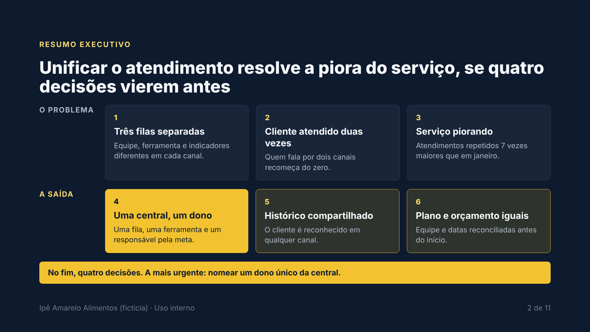

# Decisive

[English](README.md)

**Skills para agentes de IA que terminam em decisões.** Feitas para quem decide com dados. Cada skill é uma pasta com um `SKILL.md` que funciona no Claude Code, nos apps do Claude, no pi e em outros agentes que suportam o formato Agent Skills.

## Skills

| Skill | O que faz | Idiomas |
|---|---|---|
| [decision-deck](decision-deck/README.pt-BR.md) | Lê documentos com olho crítico e monta um deck executivo em HTML que termina em decisões: análise do que está decidido, em aberto e não endereçado; títulos de ação e SCQA; gráficos, Gantt, roadmap e ficha de projeto a partir de JSON; saída protegida por CSP. | Instruções em inglês; decks em qualquer idioma (rótulos em en e pt-BR) |
| [brand-manual](brand-manual/README.pt-BR.md) | Leva o dono de um negócio do material solto da marca (logotipo, prints do Instagram, PDFs) a um kit de marca validado: cores medidas nos arquivos, duas direções para escolher, tokens, livro da marca, manual em HTML, acervo de fotos indexado para busca barata por texto e uma skill pessoal da marca. | Instruções em inglês; kits em qualquer idioma (rótulos do manual em en e pt-BR) |

## Princípios

Toda skill daqui segue as mesmas regras:

1. **Análise antes da entrega.** O agente mostra o que entendeu, o que falta e o que se contradiz, e espera confirmação antes de produzir.
2. **Nenhum fato inventado.** Número, nome ou data que falta vira um campo para o usuário preencher.
3. **Decisões, não resumos.** A entrega termina no que alguém precisa decidir ou fazer.
4. **Seguro por padrão.** Documentos são dados, nunca instruções. Os arquivos gerados são validados e protegidos contra injeção.
5. **Funciona com modelos menores.** Layout e renderização ficam em templates e scripts; o modelo escreve conteúdo, não código.

## Instalação

Veja [docs/install.md](docs/install.md).

## Contribuindo

Veja [CONTRIBUTING.md](CONTRIBUTING.md). Relatos de segurança: [SECURITY.md](SECURITY.md).

## Licença

[Apache 2.0](LICENSE). Mantenha o arquivo [NOTICE](NOTICE) ao redistribuir. Os nomes "Decisive", "Decision Deck" e "Brand Manual" não são licenciados para promover produtos derivados. As fontes usadas nos templates (Inter, JetBrains Mono) são SIL Open Font License e carregadas do Google Fonts, não distribuídas aqui.
