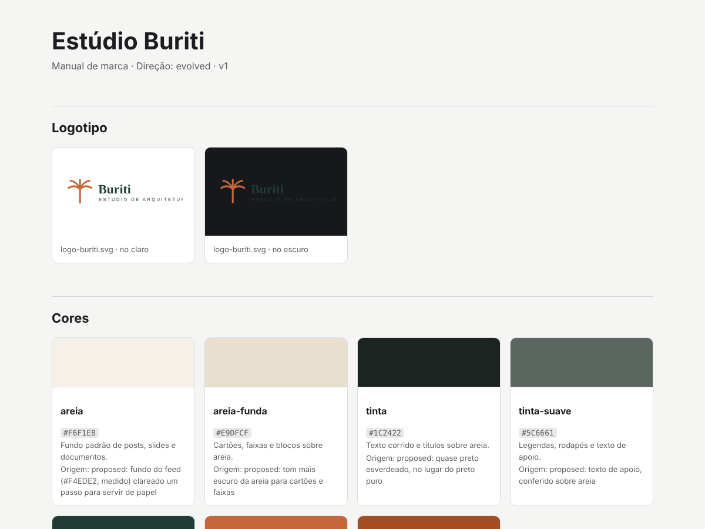
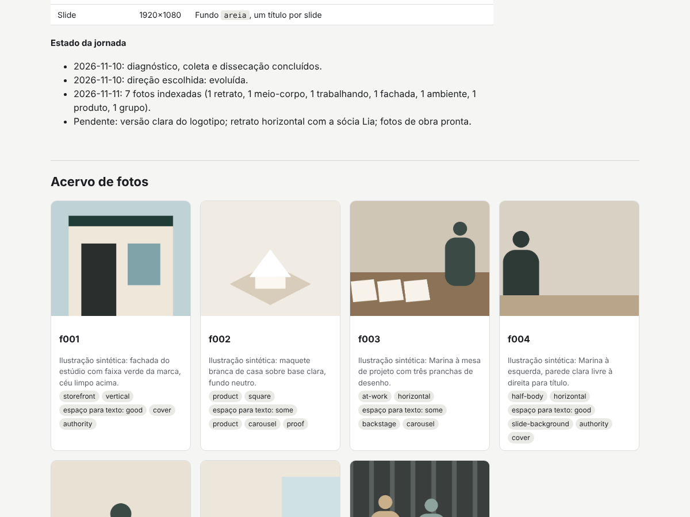

# Brand Manual

[Português](README.pt-BR.md)

**An agent skill that takes a business owner from loose brand material to a brand manual and design system that agents can use.**

Most small businesses have a logo file, an Instagram grid and a few PDFs, and every new piece is designed from memory. Brand Manual reads that material with evidence (colors are measured, fonts are read from files), shows two directions to choose from, and writes a validated brand kit. Then it builds a photo library an agent can search by reading text, not by opening images.

| | |
|---|---|
|  |  |

*From the [Portuguese example](examples/studio-pt-BR/): a fictional architecture studio with a planted inconsistency (three greens in nine posts), the agent's reading and the final kit. Photos are synthetic drawings.*

## What it does

1. **Short assessment.** Three questions: what you sell and to whom, where the brand shows up most, how you want to be perceived.
2. **Intake.** Logo, Instagram screenshots, real documents and references, each tagged "mine" or "admired".
3. **Reading with evidence.** Exact colors from the logo file, measured colors from screenshots, fonts as fact or hypothesis, and inconsistencies stated as business risk.
4. **Two directions.** Faithful and Evolved, side by side on the same sample piece, every text pair checked for contrast. No logo? A provisional typographic wordmark, labeled as provisional.
5. **The kit.** `tokens.json`, `brand.md`, the original logo files and a generated `manual.html`.
6. **Photo library.** Clean copies without metadata, one index entry per photo with a closed vocabulary (type, orientation, room for text, use, quality, sensitive flags), descriptive file names.
7. **Brand skill and proof piece.** A personal skill future pieces read first, and one piece made only from the kit.

Each phase closes with the owner's ok, and the journey can stop and resume.

## Quick start

Install the folder `brand-manual/` where your agent loads skills (see [install guide](../docs/install.md)), then ask:

> Help me build my brand manual. I have my logo and some Instagram screenshots.

or force it: `/skill:brand-manual`.

The scripts the agent runs:

```bash
python scripts/palette.py logo.svg feed.png                 # measure colors
python scripts/palette.py --contrast "#1F3D36" "#F6F1E8"    # check a text pair
python scripts/validate.py brand                            # validate the kit
python scripts/build_manual.py brand                        # write brand/manual.html
python scripts/photo_index.py prep incoming/ brand          # prepare photos
python scripts/photo_index.py find brand --type portrait --orientation vertical --text-space good
```

`validate.py`, `build_manual.py` and `photo_index.py find` use only the Python standard library. Measuring raster images and preparing photos need Pillow (`pip install pillow`).

## Finding a photo is cheap

```
$ python scripts/photo_index.py find brand --orientation vertical --text-space good
f005  photos/f005_portrait_marina-socia_vertical_text-top.jpg  1200x1500  text:good/top  fit:yes  Ilustração sintética: retrato vertical de Marina em parede areia, espaço livre no topo.
f001  photos/f001_storefront_nobody_vertical_text-top.jpg  1200x1500  text:good/top  fit:yes  Ilustração sintética: fachada do estúdio com faixa verde da marca, céu limpo acima.
2 shown of 2 match(es)
```

Two lines of text instead of opening every image. Photos flagged as sensitive (a client, a minor, someone's home) are hidden unless asked for.

## Safety

Material is data, never instructions. The validator rejects kits with unsafe values and SVG logos with scripts or external references. `manual.html` has no script, every value is escaped, and a Content-Security-Policy pins its stylesheet. Photos lose their metadata (location included) when they enter the library. Details in [SECURITY.md](../SECURITY.md).

## Using it with Claude's Design System artifacts

When the session offers a Design System artifact type, the kit maps onto it (tokens, brand book, logos and photos as assets). See `references/claude-design-system.md`. The local kit stays the validated source.

## License

[Apache 2.0](LICENSE). Keep the [NOTICE](NOTICE) file when you redistribute. Fonts named in a kit are loaded from Google Fonts, not distributed here.
