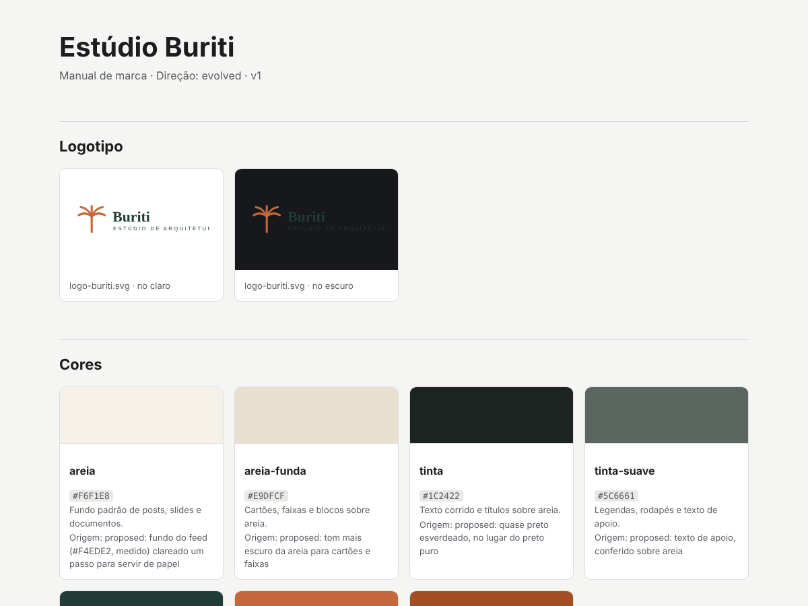
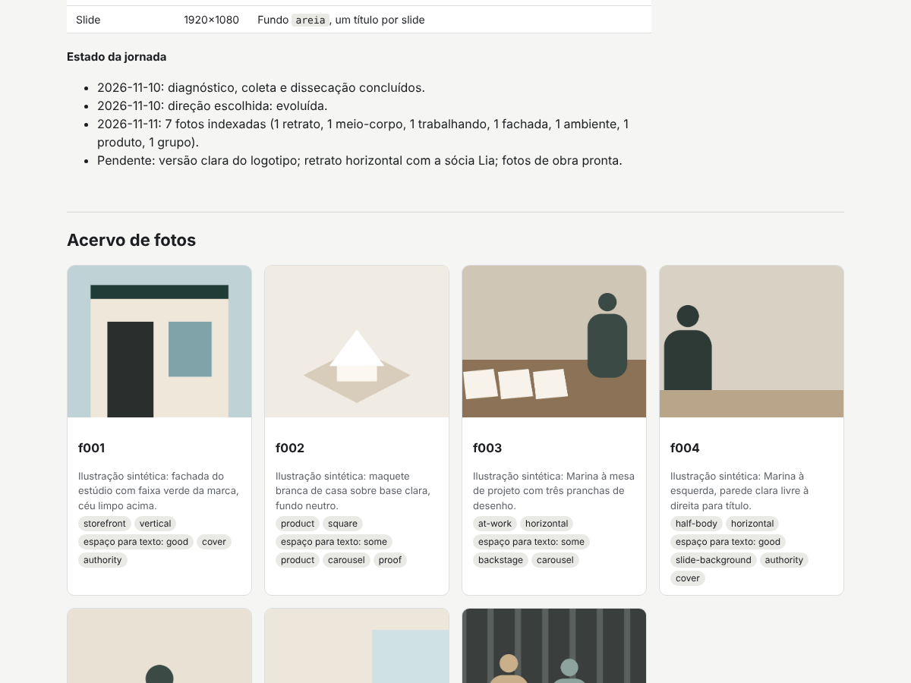

# Brand Manual

[English](README.md)

**Uma skill para agentes que leva o dono de um negócio do material solto da marca até um manual de marca e design system que os agentes conseguem usar.**

A maioria dos pequenos negócios tem um arquivo de logotipo, uma grade de Instagram e alguns PDFs, e cada peça nova é desenhada de memória. A Brand Manual lê esse material com evidência (cor se mede, fonte se lê do arquivo), mostra duas direções para escolher e grava um kit de marca validado. Depois monta um acervo de fotos que o agente consulta lendo texto, sem abrir imagem.

| | |
|---|---|
|  |  |

*Do [exemplo em português](examples/studio-pt-BR/): um estúdio de arquitetura fictício com uma inconsistência plantada (três verdes em nove posts), a leitura do agente e o kit final. As fotos são desenhos sintéticos.*

Uma página de explicação para quem não é desenvolvedor, em inglês e português: [docs/brand-manual.html](../docs/brand-manual.html).

## O que ela faz

0. **Idioma primeiro.** Uma pergunta confirma o idioma da conversa e dos artefatos.
1. **Diagnóstico rápido.** Três perguntas: o que você vende e para quem, onde a marca mais aparece, como quer ser percebido.
2. **Coleta.** Logotipo, prints do Instagram, documentos reais e referências, cada item marcado como "sou eu" ou "admiro".
3. **Leitura com evidência.** Cores exatas do arquivo do logo, cores medidas nos prints, fontes como dado ou hipótese, e inconsistências ditas como risco de negócio.
4. **Duas direções.** Fiel e Evoluída, lado a lado na mesma peça de amostra, com o contraste de cada par de texto conferido. Sem logotipo? Um wordmark tipográfico provisório, marcado como provisório.
5. **O kit.** `tokens.json`, `brand.md`, os arquivos originais do logo e um `manual.html` gerado.
6. **Acervo de fotos.** Cópias limpas, sem metadados, uma linha de índice por foto com vocabulário fechado (tipo, orientação, espaço para texto, uso, qualidade, marcações sensíveis) e nomes de arquivo descritivos.
7. **Skill da marca e peça de prova.** Uma skill pessoal que toda peça futura lê primeiro, e uma peça feita só com o kit.

Cada fase fecha com o ok do dono, e a jornada pode parar e ser retomada.

## Começo rápido

Instale a pasta `brand-manual/` onde o seu agente carrega skills (veja o [guia de instalação](../docs/install.md)) e peça:

> Me ajuda a montar o manual da minha marca. Tenho o logotipo e alguns prints do Instagram.

ou force: `/skill:brand-manual`.

Os scripts que o agente roda:

```bash
python scripts/palette.py logo.svg feed.png                 # mede as cores
python scripts/palette.py --contrast "#1F3D36" "#F6F1E8"    # confere um par de texto
python scripts/validate.py brand                            # valida o kit
python scripts/build_manual.py brand                        # grava brand/manual.html
python scripts/photo_index.py prep incoming/ brand          # prepara as fotos
python scripts/photo_index.py find brand --type portrait --orientation vertical --text-space good
```

`validate.py`, `build_manual.py` e `photo_index.py find` usam só a biblioteca padrão do Python. Medir imagens e preparar fotos pede Pillow (`pip install pillow`).

## Achar uma foto é barato

```
$ python scripts/photo_index.py find brand --orientation vertical --text-space good
f005  photos/f005_portrait_marina-socia_vertical_text-top.jpg  1200x1500  text:good/top  fit:yes  Ilustração sintética: retrato vertical de Marina em parede areia, espaço livre no topo.
f001  photos/f001_storefront_nobody_vertical_text-top.jpg  1200x1500  text:good/top  fit:yes  Ilustração sintética: fachada do estúdio com faixa verde da marca, céu limpo acima.
2 shown of 2 match(es)
```

Duas linhas de texto no lugar de abrir todas as imagens. Fotos marcadas como sensíveis (cliente, menor de idade, casa de alguém) ficam de fora, a não ser que sejam pedidas.

## Segurança

Material é dado, nunca instrução. O validador recusa kits com valores inseguros e logotipos em SVG com script ou referência externa. O `manual.html` não tem script, todo valor é escapado e uma Content-Security-Policy fixa a folha de estilo. As fotos perdem os metadados (localização incluída) ao entrar no acervo. Detalhes em [SECURITY.md](../SECURITY.md).

## Com os artifacts de Design System do Claude

Quando a sessão oferece o tipo de artifact Design System, o kit se encaixa nele (tokens, livro da marca, logos e fotos como assets). Veja `references/claude-design-system.md`. O kit local continua sendo a fonte validada.

## Licença

[Apache 2.0](LICENSE). Mantenha o arquivo [NOTICE](NOTICE) ao redistribuir. As fontes citadas em um kit são carregadas do Google Fonts, não distribuídas aqui.
