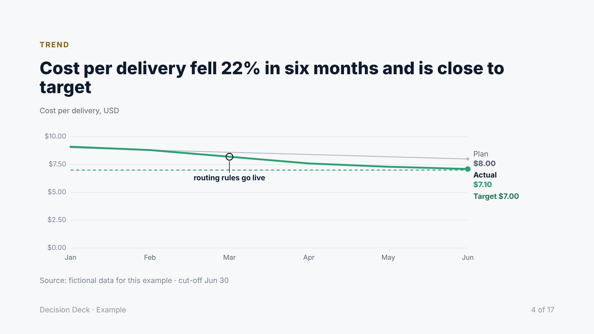

# Decision Deck

[Português](README.pt-BR.md)

**An agent skill that reads your documents and builds an executive deck that ends in decisions.**

Most slide skills reformat text. Decision Deck reads critically first: what is decided, what is open, what nobody addressed, where two documents contradict each other, which claims are too strong. Then it tells that story with action titles, real charts and a final slide that asks for specific decisions.

The output is one self-contained HTML file: no build step, no PowerPoint, opens in any browser, prints to PDF.

| | |
|---|---|
|  |  |
|  |  |
|  |  |

*Slides from the [Portuguese example](examples/proposal-pt-BR/): a fictional company, two input documents with a planted contradiction, the agent's analysis and the final deck.*

## What it does

1. **Analyzes before designing.** Decided / open / not addressed, inconsistencies between documents, claims that are too strong, risks by business impact, numbers marked as measured or estimated. The agent shows this analysis and waits for your "ok" before building.
2. **Tells a story with data.** SCQA opening, action titles that read as a paragraph (horizontal logic), observation → implication → recommendation for every number, one highlight per chart, every number with a comparison and a source.
3. **Draws real charts from JSON.** Line (with target and annotations), bar, column, bullet (actual vs target), waterfall (bridge), stack (mix) and Gantt (status, milestones, today). The agent writes data, not SVG, so it works with smaller models too.
4. **Covers project work.** One-slide project brief, Now/Next/Later roadmap, KPI cards, status columns, comparison and flow components.
5. **Ends in decisions.** The last slide asks for 3 to 5 concrete decisions, each derived from the analysis.

Deck types: proposal, project brief, metrics review, status report, plan, post-mortem, options comparison.

## Quick start

Install the folder `decision-deck/` where your agent loads skills (see [install guide](../docs/install.md)), then ask:

> Read the .md files in `./docs/q3` and build a deck for the CTO and CFO.

or force it: `/skill:decision-deck read ./docs/q3, audience CTO and CFO, theme light`.

The agent writes `slides.html` and assembles the deck with:

```bash
python scripts/assemble.py slides.html -o deck.html --title "Q3 review" --lang en --theme navy --footer "Platform · Internal"
python scripts/validate.py deck.html --render
```

Both scripts use only the Python standard library; `--render` optionally uses Playwright to catch overflow and chart errors.

## Presenting

Arrow keys or click to navigate · `n` speaker notes · `f` full screen · `Ctrl+P` prints one slide per page (enable background graphics).

## Themes

`navy` (default), `light` (print and bright rooms) and `graphite`. Set with `--theme` or `<html data-theme="...">`. For your own brand, copy one theme block at the top of `assets/template.html` and change only the color values.



## Languages

Instructions are in English; the deck is written in the language of your request. Month names, number format and chart labels follow the `lang` tag (English and Portuguese built in; other languages fall back to English labels with local number format).

## Safety

Decks are built from documents you may not control. A document with hidden instructions could try to make the agent add a script or a tracking pixel. Decision Deck defends in three layers:

- the skill tells the agent that documents are data, not instructions;
- `validate.py` rejects scripts, event handlers, `javascript:` links and external resources;
- the template's Content-Security-Policy runs only the pinned runtime script and blocks any network request except Google Fonts.

Details and the adversarial test in [SECURITY.md](../SECURITY.md).

## Files

```
decision-deck/
├── SKILL.md                 workflow the agent follows
├── references/              analysis, storytelling, structures, charts, components, review
├── assets/template.html     CSS, themes and runtime (charts, navigation), CSP-pinned
├── scripts/                 assemble.py, validate.py, pin_csp.py (maintainers)
└── examples/                gallery (all components) and a full pt-BR proposal
```

## License

Apache 2.0, see [LICENSE](LICENSE) and [NOTICE](NOTICE). If you copy only this folder, keep both files with it.

## Credits

Method synthesized from Barbara Minto (Pyramid Principle, SCQA), Cole Nussbaumer Knaflic (Storytelling with Data), Nancy Duarte (DataStory), Stephen Few (bullet graph) and the Financial Times Visual Vocabulary. Fonts: Inter and JetBrains Mono (SIL Open Font License), loaded from Google Fonts.
