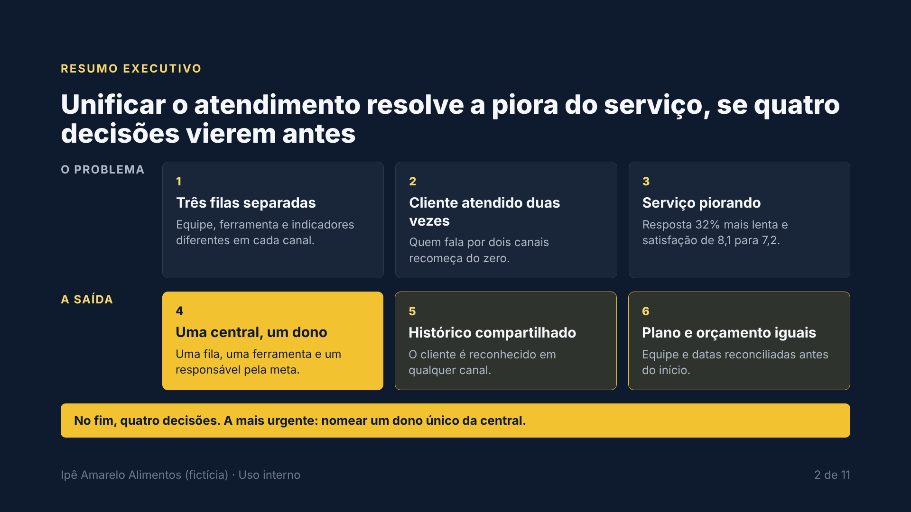
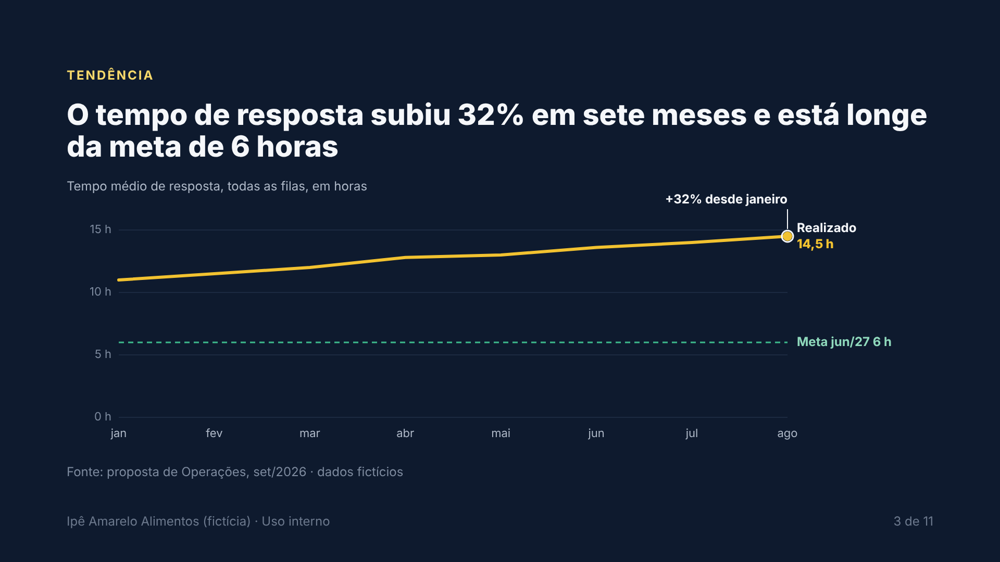
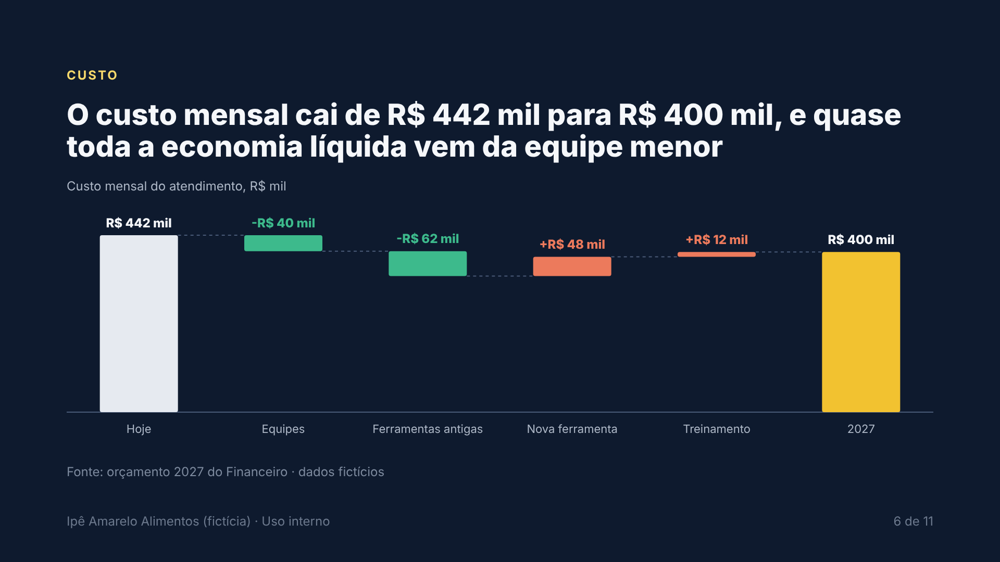
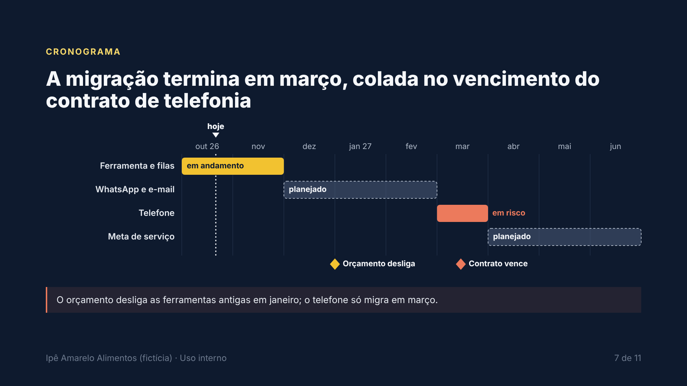
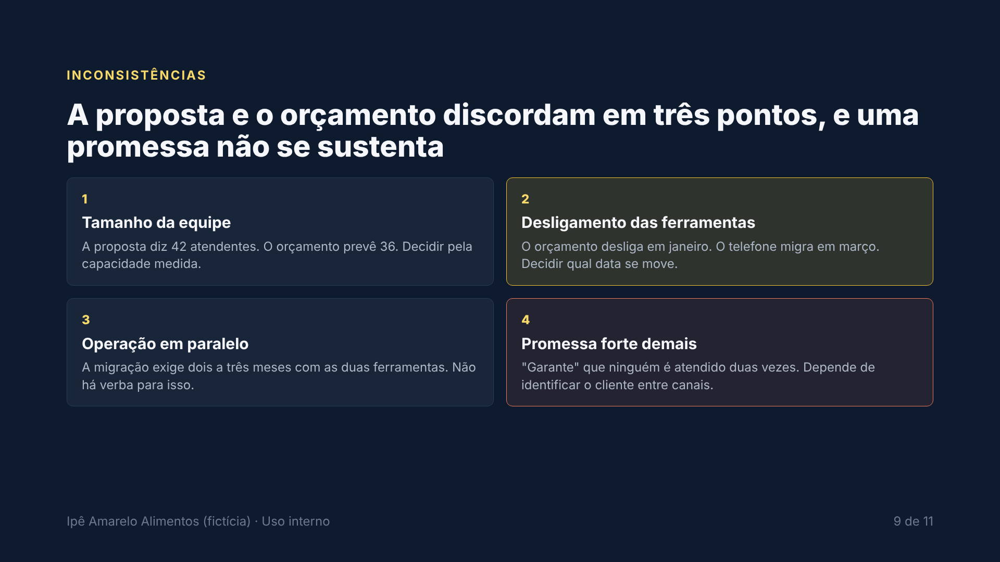
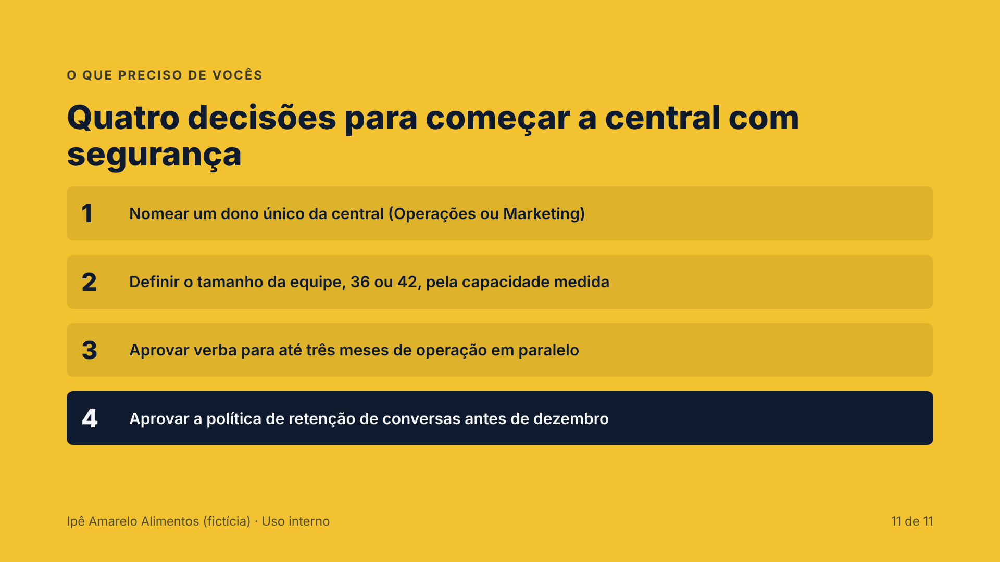

# Decision Deck

[English](README.md)

**Uma skill para agentes de IA que lê seus documentos e monta um deck executivo que termina em decisões.**

A maioria das skills de slides reformata texto. A Decision Deck lê com olho crítico primeiro: o que está decidido, o que está em aberto, o que ninguém endereçou, onde dois documentos se contradizem, quais afirmações são fortes demais. Depois conta essa história com títulos de ação, gráficos de verdade e um slide final que pede decisões concretas.

O resultado é um único arquivo HTML: sem build, sem PowerPoint, abre em qualquer navegador e imprime em PDF.

| | |
|---|---|
|  |  |
|  |  |
|  |  |

*Slides do [exemplo em português](examples/proposal-pt-BR/): empresa fictícia, dois documentos de entrada com uma contradição plantada, a análise do agente e o deck final.*

## O que ela faz

1. **Analisa antes de desenhar.** Decidido, em aberto e não endereçado; inconsistências entre documentos; afirmações fortes demais; riscos por impacto no negócio; números marcados como medidos ou estimados. O agente mostra essa análise e espera seu "ok" antes de construir.
2. **Conta uma história com dados.** Abertura em SCQA, títulos de ação que se leem como um parágrafo (lógica horizontal), observação, implicação e recomendação para cada número, um destaque por gráfico, todo número com comparação e fonte.
3. **Desenha gráficos a partir de JSON.** Linha (com meta e anotações), barras, colunas, bala (real contra meta), cascata (ponte), pilha (composição) e Gantt (estado, marcos, hoje). O agente escreve dados, não SVG, então funciona também com modelos menores.
4. **Cobre trabalho de projeto.** Ficha de projeto num slide, roadmap Agora/Próximo/Depois, cartões de KPI, colunas de estado, comparação e fluxo.
5. **Termina em decisões.** O último slide pede de 3 a 5 decisões concretas, todas derivadas da análise.

Tipos de deck: proposta, ficha de projeto, revisão de métricas, relatório de status, plano, post-mortem, comparação de opções.

## Começo rápido

Instale a pasta `decision-deck/` onde seu agente carrega skills (veja o [guia de instalação](../docs/install.md)) e peça:

> Leia os .md da pasta `./docs/t3` e monte um deck para o CTO e o CFO.

ou force: `/skill:decision-deck leia ./docs/t3, público CTO e CFO, tema light`.

O agente escreve `slides.html` e monta o deck com:

```bash
python scripts/assemble.py slides.html -o deck.html --title "Revisão do T3" --lang pt-BR --theme navy --footer "Plataforma · Uso interno"
python scripts/validate.py deck.html --render
```

Os dois scripts usam só a biblioteca padrão do Python; `--render` usa o Playwright, se instalado, para pegar texto estourando e erro em gráfico.

## Apresentando

Setas ou clique para navegar · `n` notas do apresentador · `f` tela cheia · `Ctrl+P` imprime um slide por página (ative gráficos de fundo).

## Temas

`navy` (padrão), `light` (impressão e salas claras) e `graphite`. Escolha com `--theme` ou `<html data-theme="...">`. Para sua marca, copie um bloco de tema no topo de `assets/template.html` e troque só as cores.

## Idiomas

As instruções estão em inglês; o deck sai no idioma do seu pedido. Nomes de meses, formato de número e rótulos dos gráficos seguem a tag `lang` (inglês e português prontos; outros idiomas usam rótulos em inglês com formato de número local).

## Segurança

O deck é montado a partir de documentos que você pode não controlar. Um documento com instruções escondidas poderia tentar fazer o agente inserir um script ou um pixel de rastreamento. A Decision Deck se defende em três camadas:

- a skill diz ao agente que documentos são dados, não instruções;
- o `validate.py` rejeita scripts, handlers de evento, links `javascript:` e recursos externos;
- a Content-Security-Policy do template só executa o script do runtime (fixado por hash) e bloqueia qualquer pedido de rede que não seja o Google Fonts.

Detalhes e o teste adversarial em [SECURITY.md](../SECURITY.md).

## Licença

Apache 2.0, veja [LICENSE](LICENSE) e [NOTICE](NOTICE). Se copiar só esta pasta, mantenha os dois arquivos junto.

## Créditos

Método sintetizado de Barbara Minto (Princípio da Pirâmide, SCQA), Cole Nussbaumer Knaflic (Storytelling with Data), Nancy Duarte (DataStory), Stephen Few (bullet graph) e o Visual Vocabulary do Financial Times. Fontes Inter e JetBrains Mono (SIL Open Font License), carregadas do Google Fonts.
